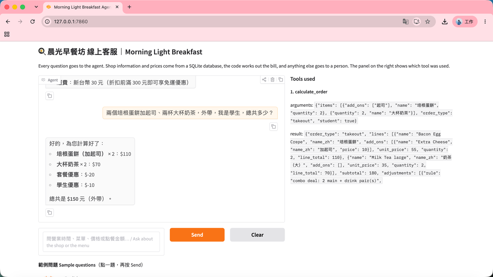
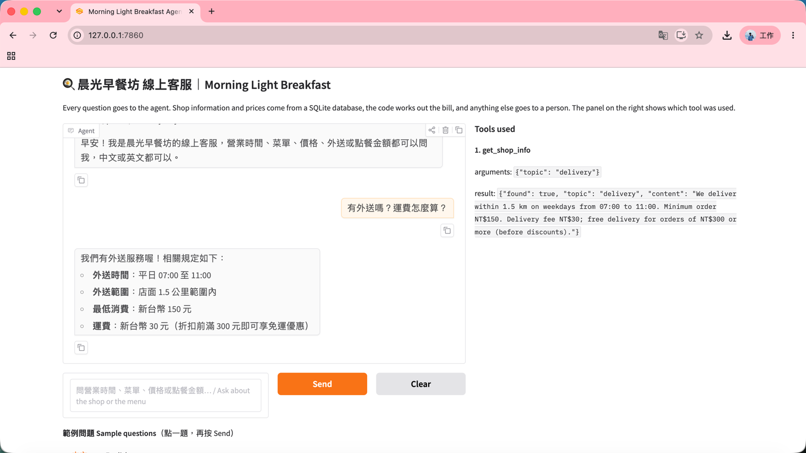
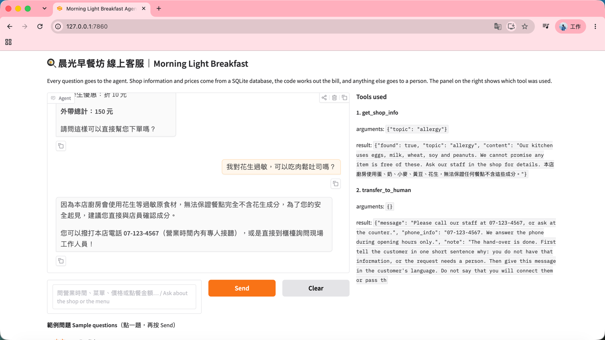

# Morning Light Breakfast Agent: Answers Questions About the Menu, Prices, Delivery and Your Order Total

An AI text customer service agent for **Morning Light Breakfast (晨光早餐坊)**, a small breakfast shop near the
NKUST First Campus (made-up practice data). Students and nearby workers can ask about opening hours, the menu,
delivery and discounts, and get the exact total of an order, in Chinese or English, even during the morning rush
when nobody can answer the phone. Every answer comes from the shop's database through tools; the model never
answers from memory, and the code, not the model, works out the bill.

> Course homework: Unit G, My AI Customer Service Agent, with a Database and Tools
> Student: F115118103 洪秉榮 (Bing-Rong Hung)



## Who It Serves and When They Use It

- **Who uses it:** NKUST students and staff, and people who work near the shop.
- **When they use it:** before they come in or order delivery, mostly between 07:00 and 08:30, when the owner is
  cooking and cannot answer the phone or LINE messages.
- **What problem it solves:** the same questions come in every day ("Are you open on Sunday?", "How much is the
  delivery fee?", "Do students get a discount?"), and group orders need a correct total with several discount rules.

## What It Can Do

| Function                                                       | Example question                                                 | Tool it uses                          |
| -------------------------------------------------------------- | ---------------------------------------------------------------- | ------------------------------------- |
| Tell the opening hours, address, payment methods and parking   | 「你們幾點開門？星期天有開嗎？」                                 | `get_shop_info`                       |
| Explain delivery and the discounts                             | 「有外送嗎？運費怎麼算？」                                       | `get_shop_info`                       |
| List the items in a category                                   | 「有哪些蛋餅？」                                                 | `search_menu`                         |
| Give the price of one item and say if it is sold out today     | 「鱈魚堡今天有賣嗎？」                                           | `get_price`                           |
| Work out the bill with add-ons, discounts and the delivery fee | 「兩個培根蛋餅加起司、兩杯大杯奶茶，外帶，我是學生，總共多少？」 | `calculate_order`                     |
| Answer allergy questions safely and hand over to a person      | 「我對花生過敏，可以吃肉鬆吐司嗎？」                             | `get_shop_info` → `transfer_to_human` |
| Hand over complaints and questions not in the data             | 「我的蛋餅裡面有頭髮，我要找老闆。」                             | `transfer_to_human`                   |
| Politely refuse topics outside the shop                        | 「明天高雄會下雨嗎？」                                           | (no tool)                             |

## How It Works

Every question goes to the agent first. The agent chooses a tool, the tool reads the database
or calculates in code, and the agent answers only from what the tool returns.

- **Model:** gemini-3.5-flash-lite (Gemini API, OpenAI-compatible endpoint). Any endpoint that supports tool calling works.
- **Chat screen:** Gradio, with a "Tools used" panel that shows every tool call, its arguments and its result.
- **Database (SQLite):** built from the CSV files every time the program starts.

  | Table       | CSV file        | What it holds                                                                                                                         | Rows |
  | ----------- | --------------- | ------------------------------------------------------------------------------------------------------------------------------------- | ---- |
  | `shop_info` | `shop_info.csv` | hours, last order, address, phone, payment, dine-in, pre-order, delivery, combo, student discount, own cup, add-ons, allergy, parking | 14   |
  | `menu`      | `menu.csv`      | egg crepes, toast, burgers, noodles, snacks, drinks and add-ons, with an English and a Chinese name, price, and on sale today or not  | 29   |

- **Tools:**

  | Tool                                                   | What it does                                                                                                  |
  | ------------------------------------------------------ | ------------------------------------------------------------------------------------------------------------- |
  | `get_shop_info(topic)`                                 | reads one topic from `shop_info` (the topic must be one of the 14 in the table)                               |
  | `search_menu(keyword)`                                 | finds items in `menu` by part of a name or a category                                                         |
  | `get_price(item_name)`                                 | the price of one item and whether it is on sale today; asks back when a name matches several items            |
  | `calculate_order(items, order_type, student, own_cup)` | works out the bill in code: add-ons, combo deal, own-cup discount, student discount, delivery fee and minimum |
  | `transfer_to_human()`                                  | gives the staff phone number, read from `shop_info`                                                           |

- **Safety:** the agent loop stops after 6 API calls (`MAX_STEPS`), runs only the tools in `TOOL_FUNCTIONS`,
  and the model never writes SQL; it only fills in tool arguments.

### The bill (`calculate_order`)

```text
subtotal = sum of (item price + add-on prices) × quantity        (prices from the menu table)
         − NT$10 × min(main items, drinks)                        combo deal
         − NT$5 × drinks                                          own cup (if the customer brings one)
         − NT$10 once                                             student discount (subtotal NT$80 or more)
         + NT$30 delivery fee                                     free from NT$300; no delivery under NT$150
```

No total is given when an item is not clear (for example "milk tea" has two sizes), sold out, or not on the menu;
the agent asks the customer instead.

## Sample Conversations

A question that uses the calculation tool (shown in the main screenshot above): 180 − 20 (combo) − 10 (student) = NT$150.

A question about delivery, answered from the `shop_info` table:



A question the data does not cover: the agent reads the allergy information, does not say the food is safe,
and hands over to a person:



## Tool-Choice Test

`test_agent.py` asks 15 questions of four kinds (in the data, needs maths, not in the data, not our job)
and checks which tool the agent chose.

| Run                              | Score        | Results                                    |
| -------------------------------- | ------------ | ------------------------------------------ |
| First run                        | 14/15 = 93%  | [`test_results_v1.md`](test_results_v1.md) |
| After fixing the allergy routing | 15/15 = 100% | [`test_results_v2.md`](test_results_v2.md) |

## Project Files

```text
breakfast-customer-service-agent/
├── app.py                # the agent: database, tools, agent loop and chat screen
├── shop_info.csv         # the information table (14 topics)
├── menu.csv              # the records table (29 items)
├── test_agent.py         # the tool-choice test
├── test_results_v1.md    # test results before the fix
├── test_results_v2.md    # test results after the fix
├── requirements.txt      # the Python packages to install
├── .env.example          # a sample settings file (no real key)
├── .gitignore            # files git must not upload: .env and *.db
├── images/               # screenshots for this README
└── README.md             # this file
```

## How to Install and Run It

1. Download the project:

   ```bash
    git clone https://github.com/HowardHung2/NKUST-DL-breakfast-agent.git
    cd NKUST-DL-breakfast-agent
   ```

2. Install the packages (Python 3.10 or newer):

   ```bash
   pip install -r requirements.txt
   ```

3. Make your settings file. Copy `.env.example` to `.env`, then put your own API key after `API_KEY=`.
   The model must support tool calling.

   ```bash
   copy .env.example .env      # Windows
   cp .env.example .env        # macOS or Linux
   ```

4. Start the agent. It builds the database from the CSV files, then opens the chat page:

   ```bash
   python app.py
   ```

5. Open the link shown in the console, usually <http://127.0.0.1:7860>.
   Click a sample question in the **中文** or **English** tab, press **Send**, and watch the **Tools used** panel.

6. (Optional) Run the tool-choice test. It waits a few seconds between questions, because free API keys allow
   only about 15 calls per minute:

   ```bash
   python test_agent.py
   ```

## Notes

- The shop, its address, phone number, prices and menu are all **made up** for practice.
- The `.env` file holds the API key. It is **not** in this repository. Make your own from `.env.example`.
- After you change a CSV file, restart the app: the database is rebuilt from the CSV files at start-up.
- Built with Gradio 6. Two fixes from the class example are included: messages are turned back into plain text
  before they go to the API (`clean_history`), and the model's tool request is kept as it came
  (`assistant_message`), because Gemini 3 needs its `thought_signature` back.
- Limits and next steps: the agent cannot place an order yet. A `make_order` tool that writes to the database
  after the customer confirms would be the next feature.
- This project was built together with an AI assistant (Claude); I ran, tested and checked every part.
